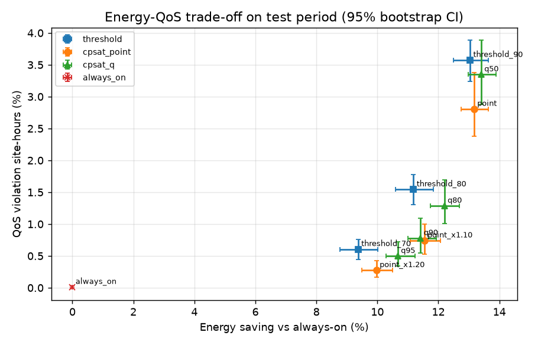

# GreenRAN AI — AI in Telecom competition project

[](https://github.com/rominavalinejad/Greenran-AI/actions/workflows/tests.yml)    

GreenRAN AI is our entry to the **AI in Telecom** competition (Sustainable & Green Telecom track):
uncertainty-aware cell sleeping that plans capacity-cell sleep with quantile/conformal day-ahead forecasts and CP-SAT,
evaluated on real Telecom Italia Milan traffic.

## Setup

```bash
python -m venv .venv && . .venv/bin/activate
pip install -r requirements.txt
cp .env.example .env   # fill LLM_BASE_URL and LLM_API_KEY (and LLM_MODEL) only for the optional LLM runs
```

`.env` is git-ignored; never commit real keys. The offline pipeline and the tests run without any key.

`GREENRAN_GUESTBOOK_EMAIL` is only needed to re-download the raw data (the processed subset is already in `data/`).

## Run

```bash
python -m pytest -q        # unit tests
python run_all.py          # main experiment -> results/ (add --quick for a short run)
python run_v6.py           # v6 conformal / matched-energy / rolling experiments -> results_v6/ (long on CPU)
streamlit run app.py       # dashboard demo
```

## Key results (copied from `results_v6/results_v6.md`, one-shot planning on test, 95% CI)

| Strategy | Saving % (95% CI) | QoS violation % (95% CI) |
|---|---|---|
| cpsat_point | 13.17 [12.73, 13.62] | 2.81 [2.32, 3.30] |
| cpsat_point_x1.10 | 11.54 [11.06, 12.03] | 0.74 [0.52, 0.98] |
| cpsat_q90 | 11.42 [10.95, 11.88] | 0.78 [0.54, 1.04] |
| cpsat_cq90 | 11.54 [11.07, 12.01] | 0.84 [0.59, 1.13] |

**Caveats:** at matched energy a point forecast with a 10 % margin performs about the same as P90, so the benefit
comes mainly from provisioning headroom; energy is model-estimated (EARTH power model), grid-square activity is only
a proxy for cell load, the site layout is synthetic, and the test window is 4 days. See Limitations below.

## Quick push

```bash
git init
git add .
git commit -m "Initial commit"
git branch -M main
git remote add origin <URL>
git push -u origin main
```

---

# GreenRAN AI — uncertainty-aware cell sleeping on real Milan traffic

Track: **Sustainable & Green Telecom**. Team: Matin Shirazi et al.

**Research question.** Do uncertainty-aware (quantile / chance-constrained) sleep decisions reduce
QoS violations at similar energy savings compared with point-forecast decisions and a fixed-threshold rule?

## Pipeline

```
Milan grid activity ──► hourly site load ──► XGBoost day-ahead forecasts (point + P50/P80/P90/P95)
        │                                              │
        └─────► actual test traffic ◄── simulate ◄── CP-SAT sleep plan per site/day ◄─┘
                                      energy, served traffic, QoS violations, runtime, bootstrap CIs
```

1. **Data** (`src/greenran/data.py`). Telecom Italia, *Telecommunications – SMS, Call, Internet – MI*,
   Harvard Dataverse, doi:[10.7910/DVN/EGZHFV](https://doi.org/10.7910/DVN/EGZHFV) (ODbL).
   Subset: 28 days (2013‑11‑04 … 2013‑12‑01), a 20×20 block of the 100×100 grid (squares with
   row 45–64, column 40–59, i.e. central Milan, 400 squares). The daily files (~350 MB each) are
   streamed and filtered on the fly; the dataset is guestbook-gated, so the downloader submits a
   guestbook response through the Dataverse API (name etc. in `config.json`; the email is read from the `GREENRAN_GUESTBOOK_EMAIL` environment variable and the download stops with an error if it is not set). 10‑minute records are summed
   over country codes and aggregated to hours. Signal used: `internet` activity.
   **Grid-square activity is only a proxy for cell load**: it is anonymised, rescaled CDR-derived activity,
   not PRB utilisation, and the real cell layout is not published.
2. **Topology** (`topology.py`, *assumption*). Each 2×2 block of squares (≈470 m × 470 m) is one simulated
   site → 100 sites. Each site has 1 coverage cell (never sleeps) + 3 capacity-layer cells (may sleep), all of equal
   capacity; total site capacity = 1.1 × the site's peak hourly load in the training period.
3. **Power model** (`power.py`). Linear load-dependent model of Auer et al., *How much energy is needed to run a
   wireless network?*, IEEE Wireless Commun. 2011 (EARTH): `P = P0 + Δp·Pmax·ρ` when active, `P_sleep` when asleep.
   Defaults per cell: P0 = 130 W, Δp = 4.7, Pmax = 20 W, P_sleep = 75 W (EARTH macro values; mapping one cell to
   one transceiver chain is an assumption), plus an **assumed** 20 Wh wake-up energy. Load is shared evenly by active cells.
   Energy is therefore *model-estimated*, not measured.
4. **Forecasting** (`features.py`, `forecast.py`). Day-ahead (all lags ≥ 24 h, so the whole next day can be planned at
   midnight): lags 24/48/72/168 h, previous-day mean, hour-of-day, day-of-week, weekend flag, site position, site scale.
   Target is site load normalised by its training mean. XGBoost point model (squared error) and one multi-quantile
   model (`reg:quantileerror`, α = 0.5, 0.8, 0.9, 0.95; outputs sorted to avoid crossing).
   **Split by time:** train 2013‑11‑11 … 11‑24 (first week used only as lag history), validation 11‑25 … 11‑27
   (early stopping), test 11‑28 … 12‑01 (Thu–Sun, never seen in training).
5. **Optimiser** (`optimizer.py`). OR-Tools CP-SAT per site and day: binary `x[k,t]` (capacity cell k on in hour t),
   minimise `Σ (P0−P_sleep)·x + E_switch·wake-ups` s.t. active capacity ≥ demand target, symmetry breaking.
   Demand target = point forecast (optionally × margin 1.1 / 1.2) or a quantile forecast (P_q, i.e. a per-hour
   chance constraint `P(load ≤ capacity) ≥ q` under the forecast distribution).
6. **Baselines.** `always_on`; `threshold_XX` = reactive fixed threshold: wake enough cells that last hour's observed
   load would use ≤ XX % of active capacity (70/80/90 %).
7. **Evaluation** (`evaluate.py`). Decisions are replayed against **actual** test traffic: energy, served traffic,
   QoS violation = site-hour where actual demand > active capacity, unserved traffic share, CP-SAT solve time.
   3 forecast seeds (XGBoost subsampling), paired cluster bootstrap over site-days (2000 resamples) for 95% CIs and
   paired differences, and a one-at-a-time power-model sensitivity (P0, P_sleep, E_switch) with re-optimisation.

## Run

```bash
python -m venv .venv && . .venv/bin/activate
pip install -r requirements.txt
python run_all.py            # full run (download ~1 min on a fast link, then a few minutes on CPU)
python run_all.py --quick    # 1 seed, 300 bootstrap draws, no sensitivity
pytest -q
streamlit run app.py         # dashboard
```

Outputs in `results/`: `summary.csv`, `metrics_per_seed.csv`, `bootstrap_ci_per_seed.csv`, `paired_differences.csv`,
`forecast_metrics.csv`, `optimizer_runtime.csv`, `sensitivity_power.csv`, `decisions_seed*.parquet`, `cells.csv`,
`frontier.png`, `results.md`, `run_meta.json`. The section below is regenerated by `make_report.py`.

## Results

<!-- RESULTS:START -->
_Generated by `make_report.py` from `results/` (run: seeds [0, 1, 2], 400 grid squares -> 100 sites, test 2013-11-28..2013-12-01, 9600 site-hours, quick=False, total runtime 158.4 s)._

| Strategy | Energy saving vs always-on % (95% CI) | QoS violation site-hours % (95% CI) | Unserved traffic % (95% CI) | Mean solve time per site-day (s) |
|---|---|---|---|---|
| always_on | 0.00 [0.00, 0.00] | 0.01 [0.00, 0.03] | 0.000 [0.000, 0.000] | - |
| threshold_70 | 9.37 [8.77, 10.01] | 0.60 [0.45, 0.76] | 0.088 [0.044, 0.144] | - |
| threshold_80 | 11.18 [10.59, 11.83] | 1.54 [1.30, 1.78] | 0.181 [0.122, 0.251] | - |
| threshold_90 | 13.04 [12.49, 13.63] | 3.57 [3.24, 3.89] | 0.423 [0.351, 0.500] | - |
| cpsat_point | 13.17 [12.75, 13.65] | 2.81 [2.38, 3.38] | 0.181 [0.141, 0.231] | 0.0024 |
| cpsat_point_x1.10 | 11.54 [11.09, 12.06] | 0.74 [0.53, 1.00] | 0.036 [0.021, 0.053] | 0.0023 |
| cpsat_point_x1.20 | 9.97 [9.49, 10.49] | 0.27 [0.17, 0.43] | 0.014 [0.006, 0.028] | 0.0021 |
| cpsat_q50 | 13.40 [12.97, 13.89] | 3.35 [2.88, 3.89] | 0.199 [0.157, 0.248] | 0.0025 |
| cpsat_q80 | 12.20 [11.74, 12.69] | 1.28 [1.01, 1.70] | 0.067 [0.047, 0.100] | 0.0023 |
| cpsat_q90 | 11.42 [11.00, 11.93] | 0.78 [0.54, 1.09] | 0.041 [0.025, 0.066] | 0.0023 |
| cpsat_q95 | 10.67 [10.29, 11.24] | 0.50 [0.34, 0.72] | 0.022 [0.012, 0.037] | 0.0022 |

Point estimates are means over seeds; CIs are a paired site-day cluster bootstrap on the first seed. Seed-to-seed SD of saving / violation rate is in `results/summary.csv`.

**Forecast quality on test (mean over seeds):**

| Metric | Value |
|---|---|
| mae_point | 997.164 |
| mape_point_pct | 12.712 |
| best_iter_point | 77.000 |
| best_iter_quantile | 1243.333 |
| coverage_q50_pct | 72.906 |
| pinball_q50 | 466.122 |
| coverage_q80_pct | 90.222 |
| pinball_q80 | 300.007 |
| coverage_q90_pct | 94.885 |
| pinball_q90 | 189.447 |
| coverage_q95_pct | 97.288 |
| pinball_q95 | 114.080 |

**Paired differences (A − B, percentage points, 95% bootstrap CI):**

| A | B | Metric | Diff | CI |
|---|---|---|---|---|
| cpsat_q90 | cpsat_point | saving_pct | -1.72 | [-1.82, -1.61] |
| cpsat_q90 | cpsat_point | violation_rate_pct | -2.07 | [-2.47, -1.70] |
| cpsat_q90 | cpsat_point | unserved_pct | -0.14 | [-0.18, -0.10] |
| cpsat_q90 | cpsat_point_x1.10 | saving_pct | -0.10 | [-0.16, -0.03] |
| cpsat_q90 | cpsat_point_x1.10 | violation_rate_pct | 0.05 | [-0.06, 0.17] |
| cpsat_q90 | cpsat_point_x1.10 | unserved_pct | 0.01 | [-0.00, 0.02] |
| cpsat_q90 | threshold_80 | saving_pct | 0.28 | [-0.02, 0.54] |
| cpsat_q90 | threshold_80 | violation_rate_pct | -0.75 | [-1.06, -0.41] |
| cpsat_q90 | threshold_80 | unserved_pct | -0.14 | [-0.21, -0.07] |
| cpsat_q95 | cpsat_point_x1.20 | saving_pct | 0.78 | [0.69, 0.87] |
| cpsat_q95 | cpsat_point_x1.20 | violation_rate_pct | 0.23 | [0.11, 0.35] |
| cpsat_q95 | cpsat_point_x1.20 | unserved_pct | 0.01 | [0.00, 0.01] |
| cpsat_q80 | cpsat_point_x1.10 | saving_pct | 0.65 | [0.58, 0.71] |
| cpsat_q80 | cpsat_point_x1.10 | violation_rate_pct | 0.58 | [0.40, 0.79] |
| cpsat_q80 | cpsat_point_x1.10 | unserved_pct | 0.04 | [0.02, 0.06] |

**Power-model sensitivity (seed 0, re-optimised):** saving % / violation %

| p0 | p_sleep | e_switch | threshold_80 | cpsat_point | cpsat_point_x1.10 | cpsat_q90 | cpsat_q95 |
|---|---|---|---|---|---|---|---|
| 100 | 75 | 20 | 6.0 / 1.5 | 7.2 / 2.9 | 6.2 / 0.8 | 6.2 / 0.8 | 5.8 / 0.5 |
| 160 | 75 | 20 | 14.8 / 1.5 | 17.4 / 2.9 | 15.3 / 0.8 | 15.2 / 0.8 | 14.3 / 0.5 |
| 130 | 40 | 20 | 18.5 / 1.5 | 21.7 / 2.9 | 19.1 / 0.8 | 18.9 / 0.8 | 17.8 / 0.5 |
| 130 | 100 | 20 | 6.0 / 1.5 | 7.1 / 2.9 | 6.2 / 0.8 | 6.1 / 0.8 | 5.7 / 0.5 |
| 130 | 75 | 0 | 11.5 / 1.5 | 13.4 / 2.9 | 11.8 / 0.8 | 11.8 / 0.8 | 11.0 / 0.5 |
| 130 | 75 | 60 | 10.6 / 1.5 | 12.7 / 2.7 | 11.0 / 0.7 | 10.9 / 0.8 | 10.2 / 0.5 |
<!-- RESULTS:END -->



## Interpretation guide

Compare strategies at *similar energy saving*: a quantile plan should be judged against the point plan with a
margin (and the threshold rule) that saves about as much energy, not only against the raw point plan. See
`paired_differences.csv` and `frontier.png`. Conclusions in the competition write-up must be read off these files.

## What the current run shows (read with the tables above)

- Planning on the quantile forecast (P90) instead of the raw point forecast cuts QoS-violation hours a lot, at the cost of
  a smaller energy saving (see `cpsat_q90` vs `cpsat_point` in `paired_differences.csv`).
- Against the reactive fixed threshold at 80 %, P90 planning gives fewer violations at a statistically indistinguishable saving.
- **But** at matched energy, a point forecast with a simple 10 % safety margin performs about the same as P90
  (difference in violation rate not significant). So in this setting the benefit comes mainly from *provisioning headroom*;
  quantile models give a principled, calibrated way to set it (empirical P90 coverage is in the forecast table), not a free gain.
- Optimisation is cheap (milliseconds per site-day), so the CP-SAT step is not a deployment bottleneck.

## Limitations (honest)

- Grid-square activity ≠ cell load; units are anonymised; the site/cell layout and capacity sizing are synthetic assumptions.
- Power model parameters are literature values/assumptions; absolute kWh are model estimates. Sensitivity only covers a few one-at-a-time variations.
- Small study: 100 sites, one area of Milan, 4 test days (incl. a weekend) from late 2013; no holiday/event shift testing.
- Hourly granularity; no modelling of wake-up latency, coverage holes, neighbour-cell offloading or user-level QoS.
  Violation is a capacity proxy (demand > active capacity), not throughput/latency.
- Quantile forecasts are not recalibrated (e.g. conformal); empirical coverage is reported instead.
- Bootstrap treats site-days as independent; spatial correlation between neighbouring sites may make CIs too narrow.

## Prior work

- Akman et al., *Energy Saving and Traffic Steering Use Case and Testing by O-RAN RIC xApp/rApp Multi-vendor
  Interoperability*, arXiv:2409.19807 (2024) — O-RAN energy-saving use case and test methodology.
- Habib et al., *Transformer-Based Wireless Traffic Prediction and Network Optimization in O-RAN*, arXiv:2403.10808 (2024) —
  Autoformer traffic forecasts trigger a cell-sleeping rApp / traffic-steering xApp via thresholds on the forecast (simulated data).
- Wu et al., *Deep Reinforcement Learning with Spatio-temporal Traffic Forecasting for Data-Driven Base Station Sleep Control*
  (DeepBSC), arXiv:2101.08391 — GS-STN forecasts on the same Milan dataset + DDPG sleep control with switching cost.
- 3GPP TR 38.864, *Study on network energy savings for NR* (Rel‑18): base-station energy model, sleep states and
  evaluation methodology.
- Auer et al., IEEE Wireless Communications 18(5), 2011 (EARTH power model).
- Barlacchi et al., *A multi-source dataset of urban life in the city of Milan and the Province of Trentino*, Scientific Data 2, 150055 (2015).

Unlike these works, which act on point forecasts, this MVP makes the sleep decision explicitly chance-constrained via quantile forecasts and
reporting the energy–QoS frontier with uncertainty, on public real data.

## v6 experiments

`python run_v6.py` (about 10 min on CPU) runs the pre-registered protocol in `results_v6/protocol_v6.md`:
split conformal recalibration of the quantile forecasts on the validation window, a matched-energy
comparison tuned on validation only, and a rolling day-by-day forecast/plan/apply loop. All outputs
go to `results_v6/` (`results_v6.md` is the rendered report, `NOTES.md` the interpretation);
`results/` from `run_all.py` is unchanged. The dashboard shows the rolling loop per site when
`results_v6/` exists.
